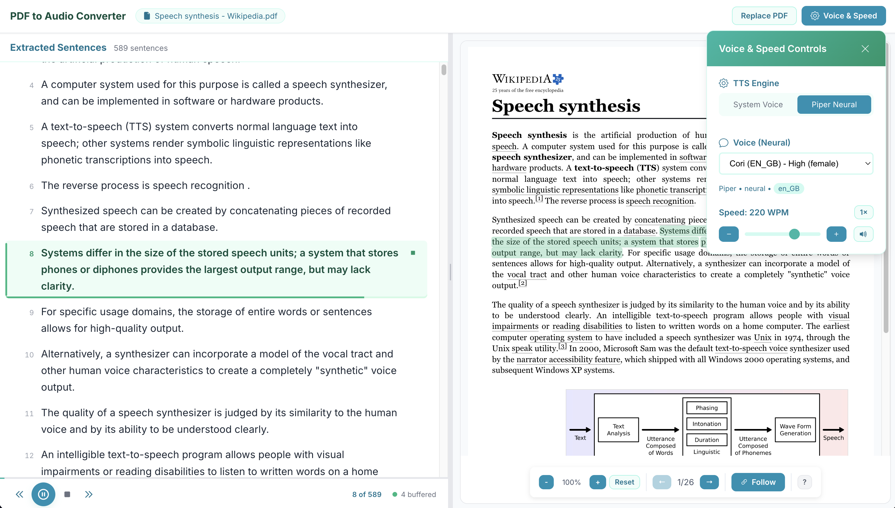

# PDF Narrator

Reads PDFs aloud, highlighting each sentence in the PDF as it is spoken.



## What it does

- **Extracts readable text** with pdf.js: columns are put in reading order, and running heads, page numbers, note marks, tables, figure captions, notes and reference lists are left out.
- **Splits sentences** with NLTK, and drops citations from the spoken text.
- **Speaks** with Piper (neural voices) or pyttsx3 (system voices), through one long-lived worker process, and caches audio by sentence and settings.
- **Highlights** the sentence being read in the PDF, including across page breaks. Alt+click a sentence in the PDF to play from there.

## Run

Requires Node.js 18+, Python 3.10+ and `ffmpeg`.

```bash
chmod +x ./run.sh  # Make the script executable
./run.sh           # Setup dependencies and start both frontend and backend
```

This installs dependencies and starts the backend on port 3001 and the frontend on the first free port in 3000 to 3005.

## Layout

- `backend/src`: Express API, PDF text extraction (`pdfText.ts`), speech worker
- `backend/src_python`: sentence splitter, audio generator, pronunciation rules
- `frontend/src`: React app; `pdfHighlight/` matches sentences to the PDF's text layer

## Test

```bash
cd frontend && CI=true npm test
```

`App.test.tsx` is a known failure: Jest can't parse `react-pdf`'s ESM build.
